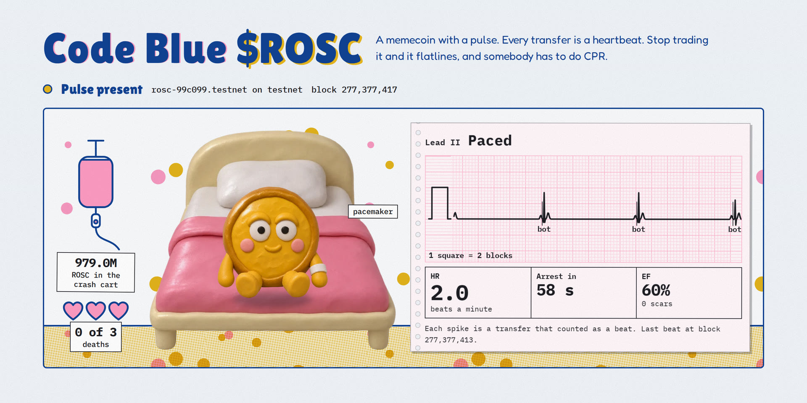
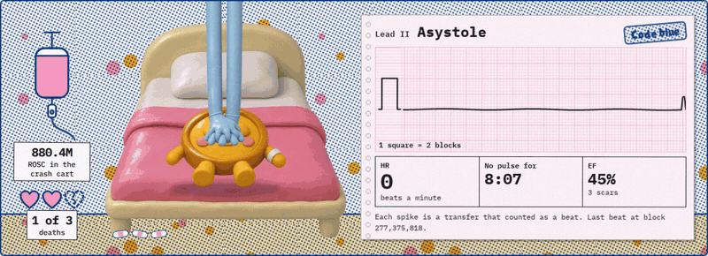
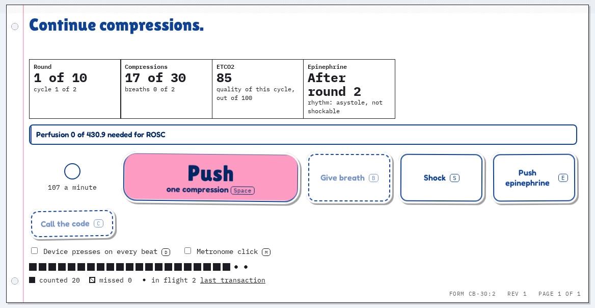
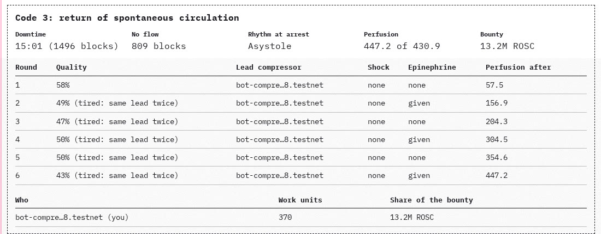
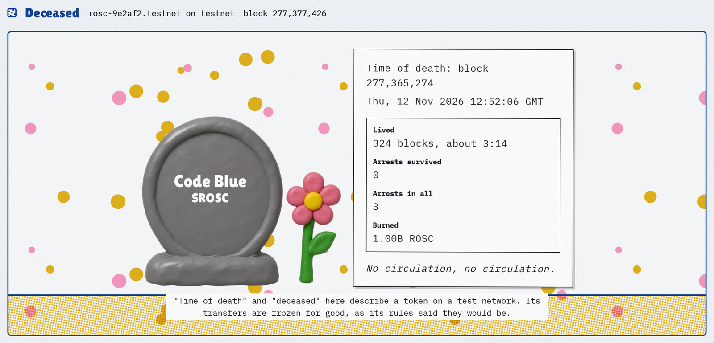
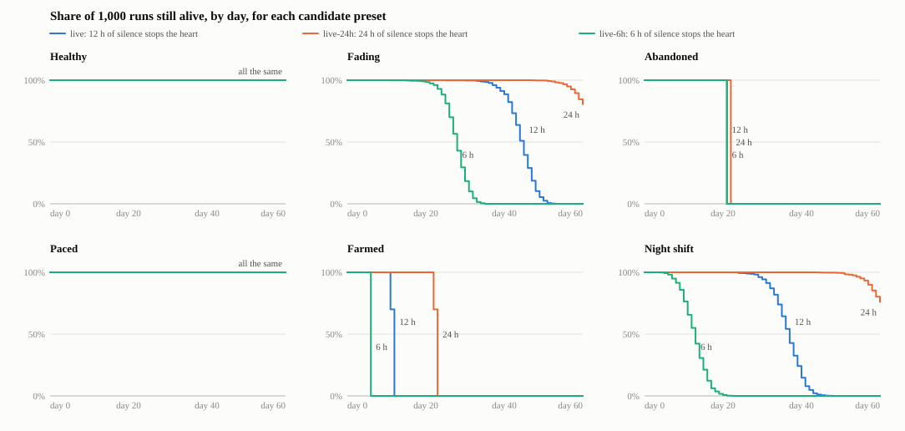
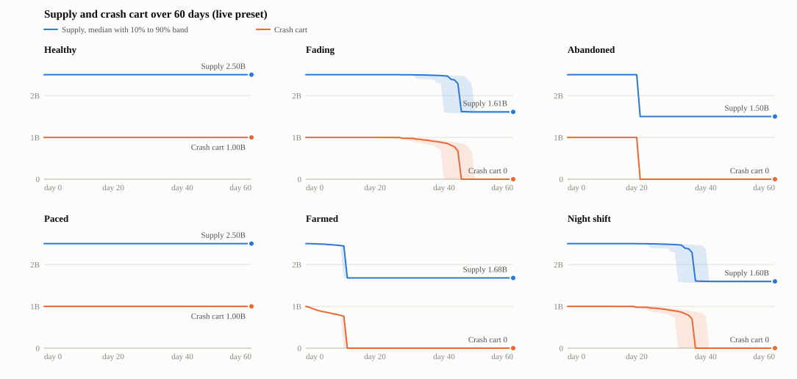
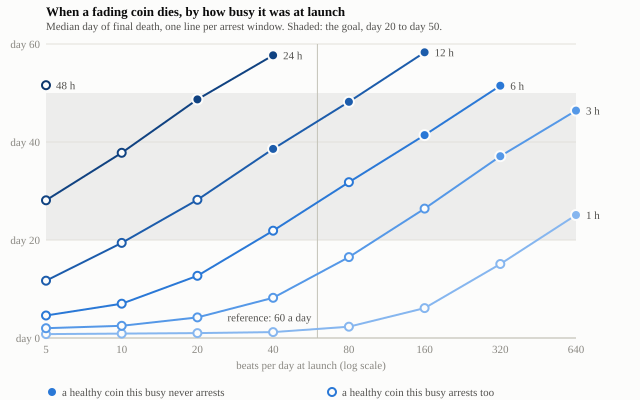

<a href="https://rosc-eight.vercel.app"></a>

# Code Blue ($ROSC)

Code Blue is a memecoin with a pulse. Every transfer is a heartbeat; when
holders stop transacting the coin goes into cardiac arrest, transfers freeze,
and holders have to do CPR on-chain, one compression per block, to bring it
back. Three deaths and it is gone for good: the page turns into a headstone
with the time of death on it.

It is a testnet toy for the NEAR HACKATHON memecoins track. It is not an
investment, not a medical device and not CPR training.

**Open the page:** <https://rosc-eight.vercel.app>. It opens on
`testnet-live`, a coin on the live preset. Nobody trades a testnet toy, so a
[scheduled job](.github/workflows/pacemaker.yml) sends one transfer between
two bot wallets every three hours, and the monitor calls that rhythm "Paced",
which is what it is. The other coins in the picker ran the demo preset, where
a minute of silence stops the heart, so expect them in arrest or under a
headstone. `make demo` deploys fresh ones.

**The limits, up front.** The mechanic does not resist one determined person
with several accounts. One bot can keep the coin alive for 4 ROSC a day, one
person with two keys can run a whole code, and a serial rescuer can take 17.9%
of the crash cart before the coin becomes unsaveable. The
[abuse table](#how-it-can-be-abused) says what each of those costs and what
the design does about it.

## What it looks like

Every picture here is the page itself, on testnet, on 12 Nov 2026. The banner
above is [`rosc-99c099.testnet`](https://testnet.nearblocks.io/address/rosc-99c099.testnet),
kept alive by a pacer bot, which is why its rhythm reads "Paced".



A code on [`rosc-aafc38.testnet`](https://testnet.nearblocks.io/address/rosc-aafc38.testnet),
in real time: one press per block, sent from the keyboard with a key the page
holds, so there is no wallet prompt. This was the coin's third arrest and
it had gone 809 blocks with nobody at the bedside, so the save took six
rounds.

| | |
| --- | --- |
|  |  |
| The code screen. Each square is a press the chain counted. | The sheet the chain wrote when the pulse came back. |



[`rosc-9e2af2.testnet`](https://testnet.nearblocks.io/address/rosc-9e2af2.testnet)
died three times with nobody at the bedside. This is all its page will ever
show.

## See it work

You need Rust (the contract pins its own toolchain through
`rust-toolchain.toml`), [cargo-near](https://github.com/near/cargo-near) 0.23
on `PATH`, and Node 20 or newer. The testnet steps also need
[near-cli-rs](https://github.com/near/near-cli-rs).

| Do | See |
| --- | --- |
| `make demo` | A whole life on testnet in about ten minutes, with a link for every transaction. Expected output is [below](#make-demo). |
| `make test` | 50 rulebook and simulator tests, then 8 contract tests on a local sandbox chain, all passing. |
| `make sim` | Six scenarios, 1,000 runs each, written to `sim/out/` with charts in `sim/out/charts/`. Two runs give byte-identical files. |
| `cd web && npm install && npm run dev` | The bedside monitor at `http://localhost:5173`, reading the testnet coin in `deployments/`. |
| `cd web && npx playwright test` | The page's acceptance tests, in a real browser against testnet. |

### make demo

The last run, on 12 Nov 2026, deployed two fresh coins and passed all 32 of
its checks in 326 seconds. Trimmed; the whole log is in
[`bots/out/demo-last-run.log`](bots/out/demo-last-run.log).

```
$ make demo
Code Blue ($ROSC): demo on NEAR testnet
deploying testnet-demo: demo preset
  deployed and initialised at block 277364990: https://testnet.nearblocks.io/txns/2uXwEcYvkeWH8A4L5ki8Rr1eo23m8rP1nKEUxFdz3yji
  rosc-99c099.testnet has no access keys: https://testnet.nearblocks.io/txns/gx1qJ5iCU9vBxQHKcvQA4tanKSpPTixFxjQyGCD4cuL

1. Holder bots run: sinus rhythm, oxygen burn ticking
   ok  8 transfers, 8 of them beats on the monitor's trace
   ok  4 different senders: a sinus rhythm, not a paced one
   ok  oxygen burn: supply fell by 1.46 ROSC, to 2,499,999,998.53
2. A transfer from one more wallet lands as a beat on the trace
   bot-pacer sent 42 ROSC in block 277365123: https://testnet.nearblocks.io/txns/9EycLUrA7C5kGjGticrT1R3q2JxUQ2GQmDAugzqqUpf
3. The bots stop. The countdown runs out
   ok  arrest at block 277365224, 100 blocks after the last beat, with no call from anyone
   a transfer now fails: https://testnet.nearblocks.io/txns/Fw6yhtkumD1VRwMH8fezz4edNe2yA94JCYBrfuRyZD1V
   the chain says: Smart contract panicked: No pulse. Tokens cannot circulate without circulation. Start compressions.
4. The pager posts CODE BLUE
   code_blue: CODE BLUE on rosc-99c099.testnet. No pulse since block 277365224. Rhythm: asystole. Start compressions: ...#code
5. The rescue bots run the code
   bot-compressor called the code: asystole  https://testnet.nearblocks.io/txns/GLfyR5c9vbB7SJ9QkVX57ytTD3vqU7y8e4cNN1oiNR13
6. A shock on a flatline is refused
   https://testnet.nearblocks.io/txns/2txx5TFDYrdotKftH7gAZ4h9mWx8HsBXfPQJWiWFr3yT
   the chain says: Smart contract panicked: Not a shockable rhythm. Resume compressions.
7. ROSC
   ok  return of spontaneous circulation at block 277365418
   a transfer went through: https://testnet.nearblocks.io/txns/JBFcU2Tt1AenKL48qW5c26vSLiX7nPoRbmu27ujeLG8A
     round 1: quality 93.8%, lead bot-compressor, perfusion 93.83
     round 2: quality 82.2%, lead bot-airway, epinephrine, perfusion 226.03
     bounty 19,979,600.03 ROSC: bot-compressor 10,577,435.31, bot-airway 9,402,164.72
8. The second deployment: nobody answers three codes
   ok  the monitor shows 3 deaths and an empty cart, with no call from anyone
   bot-holder-1 called it: https://testnet.nearblocks.io/txns/Gr37ucmUxdH4FN9afqjJ9TZVa6DK6diCwUdpHSFgfACt
   supply 2,500,000,000 at launch, 1,500,000,000 now; 729,000,000 burned as the estate
9. Every later call fails with the time of death
   compress           Time of death was called at block 277365274.
   ft_transfer        Time of death was called at block 277365274.

Done in 326 s: 32 checks passed.
```

The rescue bots do the CPR. `HUMAN=1 make demo` waits for you to do it on the
page instead. The second coin has a shortened life (`NO_FLOW_MAX_BLOCKS` 60,
`LAZARUS_BLOCKS` 20) so three unanswered codes take three minutes and not
thirty; its deployment file says so.

The coins it left on testnet, both running the wasm with sha256
`6038da1c0634a4106dbf2401f18dac90fb7a2671eb8c00e2928cfeb6f3b52976`:

| Deployment | Contract | State |
| --- | --- | --- |
| [`deployments/testnet-demo.json`](deployments/testnet-demo.json) | [`rosc-99c099.testnet`](https://testnet.nearblocks.io/address/rosc-99c099.testnet) | Saved once, then deceased at block 277417022 after its pacer stopped |
| [`deployments/testnet-headstone.json`](deployments/testnet-headstone.json) | [`rosc-9e2af2.testnet`](https://testnet.nearblocks.io/address/rosc-9e2af2.testnet) | Deceased at block 277365274 |

A demo-preset coin arrests one minute after its last beat and is dead for good
about half an hour later, so the demo coin only stays alive while a pacer runs
(`make pacer`). `make demo` deploys fresh coins when the ones on file are used
up.

## What the track asks for

| The track asks for | Met by |
| --- | --- |
| An NEP-141 token with the mechanic in the contract, not a backend | [`contracts/rosc`](contracts/rosc/src/lib.rs): one contract. The page only reads the chain, and the pager is optional. |
| Parameters set at launch, readable by anyone, no admin key | `Config` is written once in [`new`](contracts/rosc/src/lib.rs), returned by `get_config()`, and the account has [zero access keys](#no-admin). |
| Sybil resistance good enough for a demo, limits written plainly | The [abuse table](#how-it-can-be-abused) and the paragraph at the top of this file. |
| A page with current state and a log of every mint and burn | [`web/`](web/src/App.tsx): the Monitor screen and the Chart screen. The one mint is the `ft_mint` event at launch; every burn is an `ft_burn` event and a ledger line. |
| 60 simulated days with supply over time, then parameters | [`sim/`](sim/src/main.rs), its files in [`sim/out/`](sim/out), and [`docs/params.md`](docs/params.md). |

## How it works

```
crates/codeblue-core   the rules: state machine, scoring, economics. No chain code.
contracts/rosc         the NEP-141 token. Every rule comes from codeblue-core.
sim/                   the simulator. It runs codeblue-core too.
web/                   the bedside monitor.
web/lab.html           the look lab: every colour, dot and timing on a knob. Dev server only.
bots/                  holder bots, pacer, rescue bots, pager, demo runner.
docs/params.md         every parameter, both presets, with the reason for each value.
```

The contract and the simulator run the same crate, so the simulated coin and
the deployed coin cannot disagree. The rulebook has no randomness and no
floating point.

**State is derived from the block height.** Nothing has to be poked. An
arrest, a lapsed ventilation window, a death whose condition holds and the
reopening of a code after the morgue each become true at a known block. The
next call writes them with that block's number, and `get_monitor()` shows them
before any call has. A refused call changes nothing. Code sheets and ledger
lines are written by that same call, so after a code that ended on a deadline
the page shows the outcome at once and the sheet one transaction later, and
says so in between.

The life of the coin, in order:

1. **Alive.** A transfer of at least `MIN_STROKE` between two accounts, from a
   sender whose last beat is at least `REFRACTORY_BLOCKS` old, is a beat. The
   sender pays 0.5% oxygen burn and 0.5% into the crash cart, on top of the
   amount.
2. **Arrest**, when `block - last_beat > ARREST_BLOCKS`. Transfers fail with
   `No pulse. Tokens cannot circulate without circulation. Start compressions.`
   The rhythm is VF after a busy final bucket, PEA after transfers too small
   to count, asystole otherwise.
3. **The code.** `compress()` counts once per block. Thirty close a cycle and
   open a 16-block window for two breaths from someone other than the lead
   compressor. Cycles make a round; a round adds to perfusion according to how
   tight the compressions were. After a round, VF can be shocked and
   epinephrine can be pushed every second round.
4. **ROSC**, when perfusion reaches the target. Transfers resume, the coin
   gains a scar, and rescuers split a bounty from the cart by work done.
5. **Time of death**, when nobody starts in time, compressions pause too long,
   or round 10 ends short. One death, two scars, a tenth of the cart burned.
   The third death is final and burns the rest.

The scoring borrows the shape of the adult cardiac arrest algorithm and
nothing more. The numbers are game design, not medicine.

## How it can be abused

| Case | What happens | What the design does |
| --- | --- | --- |
| Pacemaker bot | One or two accounts transfer forever and the coin never arrests. | Allowed. It costs 4 ROSC a day in fees on the live preset ([`sim/out/summary.csv`](sim/out/summary.csv), `paced`), against a faucet claim of 1,000,000. The monitor labels the rhythm as paced. |
| One person runs the code | Two keys cover compressions and breaths. | Allowed. The bounty goes to whoever does the work. |
| Serial rescuer | Someone lets a dead coin arrest and saves it every time. | The bounty shrinks with every scar and scars cap the saves. In simulation one person took 17.9% of the cart over about 21 saves before the coin died ([`sim/out/summary.csv`](sim/out/summary.csv), `farmed`). |
| Forced arrest | Someone tries to stop the heart to farm it. | Not possible alone: any qualifying transfer by anyone resets the clock. |
| Sabotaging a code | Extra or mistimed calls. | A call either counts or is ignored. Nobody can block another rescuer. |
| Wasting epinephrine | A griefer pushes every dose. | One dose per window, at most five a code, and each one helps the patient. |
| Calling death early | A griefer wants the strike. | `call_time_of_death()` fails until a death condition holds, and then only writes what is already true. |
| Late joiner | Someone arrives for the last round. | Shares follow work units, so they earn only what they did. |
| Faucet farming | New accounts drain the faucet. | Accepted on testnet. A launch with real value needs a different distribution. |
| Frozen integrations | A pool or bridge holding ROSC cannot move it during an arrest, or ever after death. | By design. Testnet only, unless a deployer sets `POST_MORTEM_TRANSFERS` at launch. |
| Leaked page key | The key in the browser can only call rescue methods. | Worst case, someone does compressions in your name. |
| Timing games | Block producers order calls within a block. | One compression counts per block and nothing is random, so order inside a block does not matter. |

**Two things the design cannot fix.**

- A community cannot be faked into existing. A paced coin is alive on-chain
  and dead in every way that matters, and the monitor shows that.
- Landing a call in a given block is partly luck. In the demo run the rescue
  bots sent one press per block and 120 of 145 were counted; the page test's
  first thirty all were ([measured on chain](#measured-on-chain)).

Things that follow from the rules and may surprise you:

- A transfer to yourself is refused, not treated as activity without a pulse.
  The token library would credit it without debiting it.
- The fees on an `ft_transfer_call` are charged on the way out and are not
  refunded if the receiver returns the tokens.
- Once a death condition holds, the code is over even if nobody has called it.
  A late compression does not rescue it.

## No admin

The contract has no owner and no upgrade method. `Config` is written in `new`
and no method writes it again. After setup the account has no access keys:

```
$ near account list-keys rosc-99c099.testnet network-config testnet now
+---+------------+-------+-------------+
| # | Public Key | Nonce | Permissions |
+---+------------+-------+-------------+
+---+------------+-------+-------------+
```

The deployer's key was deleted in
[this transaction](https://testnet.nearblocks.io/txns/gx1qJ5iCU9vBxQHKcvQA4tanKSpPTixFxjQyGCD4cuL),
after the bot accounts were created. The sandbox test
`the_account_has_no_keys_after_setup_and_storage_fits_the_fee` does the same
and then checks that nobody can sign as the contract.

The wasm cannot change its own account either. It imports 22 host functions
and none that deploys code, adds or deletes keys, or deletes the account:

```
$ cd contracts/rosc && cargo test the_wasm_cannot_change_its_own_account -- --nocapture
22 imports: sha256 read_register promise_then value_return promise_create prepaid_gas
attached_deposit current_account_id block_index predecessor_account_id register_len
storage_read storage_write promise_return storage_remove storage_has_key
promise_batch_create promise_result promise_batch_action_transfer log_utf8 input panic_utf8
test the_wasm_cannot_change_its_own_account ... ok
```

That is why the token's external methods are written out by hand in
[`token.rs`](contracts/rosc/src/token.rs) and
[`storage.rs`](contracts/rosc/src/storage.rs). The usual derive macro pulls in
`near_sdk::Promise`, which links every one of those host functions.

## Simulation

Six scenarios, 1,000 runs each over 60 simulated days, on the live preset.

| Design goal | Measured | |
| --- | --- | --- |
| A healthy coin has zero arrests in 60 days | 100.0% of runs | pass |
| A fading coin's median death falls between day 20 and day 50 | day 45 | pass |
| A realistic pair needs 4 to 12 minutes for a save | 4.3 min with no scars; 10.7 min with 5 scars | pass |
| A serial rescuer takes under 25% of the cart | 17.9% | pass |

From [`sim/out/goals.csv`](sim/out/goals.csv).





The one parameter that moved from the spec's first draft is `ARREST_BLOCKS`,
from 24 hours to 12. With 24 hours the fading coin was still alive on day 60
in 80% of runs; with 6 hours a healthy coin arrested in 14% of runs.
[`docs/params.md`](docs/params.md) gives the reason for every value.



The scenarios describe people, and those numbers are assumptions: 120 holders
making 60 transfers a day at launch, four rescuers who each show up half the
time about ten minutes after an arrest ([`sim/out/scenarios.csv`](sim/out/scenarios.csv)).
The chart above shows how the outcome moves when the community is busier or
quieter.

Two more results worth knowing. Supply only moves visibly when the coin dies:
the oxygen burn on a healthy coin is about 940 ROSC a day out of 2.5
billion, while the final death burns the whole cart. And with a 12-hour
window, arrests in the night-shift scenario are saved 46% of the time by
night against 82% by day, because the first responder is late.

## Measured on chain

Gas burnt on testnet, median per call, from
[`bots/out/gas.json`](bots/out/gas.json):

| Call | Gas |
| --- | --- |
| `compress()`, counted | 2.49 TGas |
| `compress()`, not counted | 2.42 TGas |
| `breathe()` | 2.51 TGas |
| `push_epi()` | 4.65 TGas |
| `ft_transfer` | 4.39 TGas |
| `faucet_claim()` | 3.40 TGas |
| `claim_bounty()` | 3.60 TGas |
| `call_time_of_death()` writing three deaths | 5.79 TGas |

A full two-round code cost the compressor 0.0172 NEAR. The sandbox measures a
counted compression at 2.40 TGas (`contracts/rosc/tests/sandbox.rs`).

Landing, at one press per block:

- The rescue bots counted 120 of 145 presses in the run above. The four
  cycles of 30 took 33, 31, 37 and 36 blocks.
- The page, driven from the keyboard by the acceptance test, saved a coin
  alone in 279 presses over 276 seconds, then claimed its bounty. All of its
  first thirty presses counted, and a press was marked a median of 1.75
  seconds after it was sent.
- Testnet made a block every 595 ms during the run.

## Real CPR

The page shows these in a box of their own, apart from the jokes.

| | |
| --- | --- |
| Compression rate | 100 to 120 a minute |
| Ratio, no advanced airway | 30 compressions to 2 breaths |
| Pauses in compressions | never more than 10 seconds |
| Compressor change | every 2 minutes, or sooner if fatigued |

Sources: the American Heart Association's 2025
[adult cardiac arrest algorithm](https://cpr.heart.org/-/media/CPR-Files/CPR-Guidelines-Files/2025-Algorithms/Algorithm-ACLS-CA-250527.pdf?sc_lang=en)
and
[high-quality CPR summary](https://www.vumc.org/resuscitation-program/sites/default/files/public_files/BLS/Heartsaver/Heartsaver-CPR-AED-Summary-High-Quality-CPR%20Components-2025-Guidelines.pdf).

Nothing here is training or medical advice. The joke is on the coin and on
memecoins, never on patients, families or staff. "Time of death" and
"deceased" in this project describe a token.

## The look, the pictures and the sound

The page is drawn as a print: three inks on paper, a thermal strip for the
trace, stickers for controls and one clay patient. One file,
[`web/src/look/look.json`](web/src/look/look.json), holds every choice, and
[`web/src/look/look.ts`](web/src/look/look.ts) turns it into the page's
colours and timings. The inks are declared in OKLCH. The two light inks share
one lightness and the same share of the chroma each hue can reach, type
printed on a fill is the key ink darkened until it reads, and the trace grid
is one hue from paper to heavy line.

`make web`, then `http://localhost:5173/lab.html`, opens the lab that edits
that file: click the picture for a new variation, move the knobs, save.

| What | Where | Made with |
| --- | --- | --- |
| The patient in seven poses, a rescuer's hands, the bed, the headstone | [`web/public/art/`](web/public/art/manifest.json) | Higgsfield, model `gpt_image_2_6`. 14 pictures generated, 11 used. |
| Woodblock, tuba, wrong note, whistle, flatline, trombone, fanfare, balloon | [`web/public/sounds/`](web/public/sounds/manifest.json) | The ElevenLabs sound generation API, model `eleven_text_to_sound_v2`. 27 takes generated, 8 used. |
| Type | loaded from Google Fonts | Lilita One, Fredoka, IBM Plex Mono |

Each manifest lists the exact prompt, the settings and what was done to the
file afterwards. The character is original: no prompt names an existing
character, brand or person. The fanfare is one generated kazoo note cut and
re-pitched into four. If a picture fails to load the page draws the patient
in ink instead, and if a recording fails the band plays the cue on an
oscillator.

## Built with

| Library | Version | Used for |
| --- | --- | --- |
| [near-sdk](https://github.com/near/near-sdk-rs) | 5.30.1 | The contract |
| [near-sdk-contract-tools](https://github.com/near/near-sdk-contract-tools) | 4.0.0 | NEP-141 balances, supply, events and the transfer hook |
| [cargo-near](https://github.com/near/cargo-near) | 0.23.0 | `cargo near new` for the contract projects, and the build |
| [near-sandbox](https://github.com/near/near-sandbox-rs), [near-api](https://github.com/near/near-api-rs) | 0.4.0, 0.8.7 | Contract tests on a local chain |
| [near-api-js](https://github.com/near/near-api-js) | 7.5.3 | Signing with a local key, RPC, the bots |
| [@hot-labs/near-connect](https://www.npmjs.com/package/@hot-labs/near-connect), [near-connect-hooks](https://www.npmjs.com/package/near-connect-hooks) | 0.11.4, 1.1.6 | Wallet connection |
| Vite, React, TypeScript | 6.4, 19, 7 | The page |
| Playwright | 1.65 | The page's acceptance tests |

Vite is 6 rather than the newest because Vite 8 needs Node 22.12 and the
build machine has 22.11. near-connect is 0.11.4 because the hooks package
pins that range.

Templates: `cargo near new` for the contract projects and
`npm create vite -- --template react-ts` for the page. NEAR's
[agent skills](https://github.com/near/agent-skills) (`near-smart-contracts`,
`near-dapp`, `near-api-js`) were read before any NEAR code was written.

**This repository includes AI-generated code, pictures and sound.** It was
built with Claude Code from a written spec, and every number in this file
traces to a test, a simulator file or a transaction.
